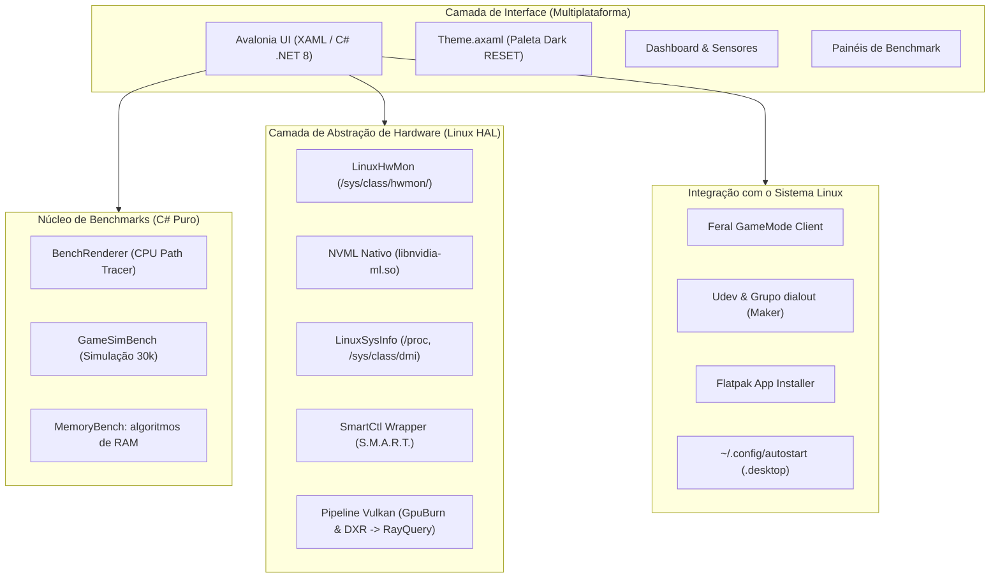

# Plano Mestre de Portabilidade: RESET EXPLODE para Linux

Este documento foi elaborado para guiar desenvolvedores e sistemas de inteligência artificial na migração completa do software **RESET EXPLODE** do ambiente Windows (.NET 8 + WPF + DirectX) para o ecossistema Linux nativo (.NET 8 + Avalonia UI + Vulkan).

### Organização atual e último resultado

O projeto está organizado em `Windows/` (referência WPF), `Shared/Benchmarks/` (algoritmos comuns), `Linux/` (porte) e `docs/` (documentação versionada). Veja [ESTRUTURA.md](ESTRUTURA.md) para caminhos atuais; descrições históricas abaixo podem citar a organização anterior. Os pontos de entrada Linux continuam em `Linux/ResetExplode.csproj` e `Linux/validate.sh`.

Exportação Maker HTML/JSON concluída com snapshot independente de portas, USB, aliases, grupos, datas e falhas. Suíte completa aprovada antes e depois da reorganização em .NET 8, com zero avisos/erros. Verificados estaticamente XML, eventos, referências e recursos; 65 fontes Windows/compartilhados movidos preservam o conteúdo original. Builds Avalonia/WPF, diálogos e hardware serial conectado permanecem pendentes. A prioridade seguinte é validar os projetos gráficos nos ambientes adequados; não considerar a migração completa.

### Estado verificado e base da migração — 22/10/2026

**Validação mais recente (prevalece sobre os estados históricos abaixo):** nesta continuação, SDK 8.0.132/runtime 8.0.32 disponíveis. Os projetos originais Core, Hardware e SmokeTests compilaram com zero avisos/erros, mantendo as referências entre assemblies; toda a suíte passou no alvo net8.0. `Linux/validate.sh --offline-net8` reproduz essa validação sem NuGet e sem alterar os alvos. Coleta real confirmou CPU/hwmon/cpufreq; NVML segue com erro 9. O build Avalonia retornou NU1301 na restauração; UI/diálogos, SMART com processo real e benchmarks completos seguem pendentes. A validação suplementar anterior em .NET 10 e os estados de implementação abaixo são históricos. Próximo passo: executar `bash Linux/validate.sh` com os pacotes acessíveis e validar os fluxos gráficos.

**Continuação — processo SMART:** testes com executável temporário validaram argumentos, códigos de saída, JSON inválido, executável ausente, limite/drenagem de stdout e stderr, timeout e cancelamento em andamento. O leitor agora aguarda a saída do processo após solicitar encerramento. Suíte completa aprovada em .NET 8, sem avisos/erros. Essa validação não acessa discos reais; smartctl com hardware, descendentes de processos e fechamento gráfico permanecem pendentes. O NuGet segue inacessível por falha de DNS.

**Continuação — smartctl instalado:** novo diagnóstico explícito `--live-smart <dispositivo>` nos SmokeTests. Executado com smartctl 7.5 e `nvme0n1`: processo real e tratamento da falha de abertura validados; resultado LEITURA INCOMPLETA porque o dispositivo de `/dev` não está disponível neste ambiente, embora conste em sysfs. Leitura efetiva de saúde segue pendente. Nomes `.` e `..` agora são rejeitados. Build sem avisos/erros e suíte completa .NET 8 aprovados. Comandos e códigos de saída documentados no README Linux.

**Continuação — Maker inicial:** `LinuxSerialCollector.cs` lista ttyUSB/ttyACM via sysfs e `/dev`, distingue fontes e identifica associação ativa a dialout/uucp pelo status do processo e grupos locais. Cartão integrado à página de sistema com coleta inicial/manual, sem sobreposição e com cancelamento no fechamento. Testes `--serial-only` e suíte completa passaram em .NET 8 (zero avisos/erros); `--live-serial` executado sem portas observadas neste ambiente. UI validada apenas estaticamente. Aliases by-id, identificação USB/driver, permissões efetivas, hardware conectado e configuração do sistema permanecem pendentes. Não há abertura de portas nem alteração de grupos/udev.

**Continuação — identificação USB serial:** fabricante/produto reportados, VID/PID e driver associado agora integram o inventário Maker, cartão e diagnóstico de terminal. A leitura resolve a hierarquia sysfs, preserva a origem dos atributos e para no dispositivo USB pai mais próximo identificado, sem completar seus dados com atributos de um hub. Testes com links reais em diretórios temporários cobrem estruturas USB serial/CDC ACM, atributos inválidos, links quebrados/circulares, remoção e snapshot anterior. Suíte completa passou em .NET 8, sem avisos/erros. Hardware conectado e interface gráfica seguem pendentes; aliases by-id e exportação são próximas extensões independentes.

**Continuação — aliases seriais by-id:** inventário Maker, cartão e diagnóstico de terminal agora associam links `/dev/serial/by-id` às portas ttyUSB/ttyACM observadas em `/dev`. Resolvem links relativos/absolutos/encadeados e apresentam contagem de entradas sem associação. Testes cobrem múltiplos aliases, links inválidos, troca de destino, remoção e snapshot independente. Suíte completa .NET 8 aprovada sem avisos/erros; XML/binding verificados. Hardware conectado e execução gráfica continuam pendentes. Os nomes dos aliases podem conter números de série; não há exportação/persistência automática. Próxima extensão independente do Maker: relatório HTML/JSON do inventário, mantendo os limites de diagnóstico já documentados.

**Atualização após criação do fork:** o diretório da base agora é `ResetExplodeForLinux/`. A mudança é do repositório; os nomes do produto, namespace e assembly continuam `ResetExplode`. O destino Avalonia foi criado em `ResetExplodeForLinux/Linux/`, sem renomear o projeto Windows. As referências históricas a `ResetExplode/` neste guia indicam a mesma base, anterior à mudança de diretório.

**Fase 1 — implementação inicial escrita; validação de execução pendente:** já existem projeto Avalonia, tema inicial, tela de benchmarks, núcleo com fontes compartilhadas de CPU, extração dos métodos de RAM, smoke tests e workflow Linux. Não foram executados build, benchmarks ou UI nesta sessão: SDK .NET ausente e falha de DNS ao tentar acessar seu instalador. Consultar `ResetExplodeForLinux/Linux/README.md` para executar e validar antes de considerar a fase concluída.

**Fase 2 — implementação inicial escrita; validação de execução pendente:** `Linux/Hardware/` contém coleta de sistema (`/proc`, DMI e os-release), carga de CPU por deltas, RAM disponível, sensores hwmon, clocks cpufreq e NVML opcional somente de leitura. A interface possui página de sistema/sensores, busca, resumo lateral e coleta sequencial em segundo plano. Há testes com arquivos simulados e modo de diagnóstico real no terminal. Ainda faltam execução com SDK, validação gráfica e teste de NVML em hardware compatível.

**Integração térmica — implementação escrita; validação pendente:** os benchmarks agora têm interrupção opcional por temperatura da CPU, habilitada inicialmente com limite de 90 °C. Pré-checagem exige leitura recente abaixo do limite; sensor ausente, leitura com idade de cinco segundos ou temperatura no limite solicitam cancelamento. Uma thread dedicada verifica snapshots com timestamp monotônico, sem depender do dispatcher. O registro distingue bloqueio, interrupção e cancelamento, sem pontuação parcial. O recurso é cooperativo e cobre apenas os sensores de CPU reconhecidos; a lógica possui testes simulados, ainda não executados nesta sessão.

**Persistência local — implementação escrita; validação pendente:** configurações térmicas em `$XDG_CONFIG_HOME/ResetExplode/settings.json` e últimas 200 execuções em `$XDG_STATE_HOME/ResetExplode/benchmarks.json`, com os padrões XDG quando necessário. `Linux/Core/LocalPersistence.cs` implementa JSON versionado, substituição atômica, backup de dados inválidos e bloqueio entre escritores. A interface restaura preferências e histórico, salva configurações pelo botão ou antes do teste e permite reenviar resultados pendentes. Execuções incompletas não têm pontuação nem métricas parciais. Há testes temporários (`--storage-only`), ainda não executados. Perfis e credenciais Windows continuam pendentes.

**Exportação de benchmarks — implementação escrita; validação pendente:** botões HTML/JSON na página de benchmarks, com snapshot de até 200 registros, métricas e contexto, identificação de pendências locais e exclusão de pontuação parcial. A função de relatórios Windows foi adaptada em `Linux/Core/BenchmarkReportBuilder.cs`, com integração Avalonia em `MainWindow.Export.cs`. Relatório completo de hardware e importação não fazem parte desta etapa. Testes disponíveis em `--report-only`; build e diálogo gráfico ainda não executados.

**Inventário de armazenamento — implementação escrita; validação pendente:** a página de sistema lista dispositivos de bloco e partições via `/sys/block`, com capacidade, modelo e flags disponíveis. `Linux/Hardware/LinuxStorageCollector.cs` usa somente leitura, sem abrir dispositivos ou inferir saúde. Coleta inicial e atualização manual rodam separadas do loop térmico. Testes com sysfs temporário em `--inventory-only` ainda não executados; montagens/espaço livre, SMART e benchmark de disco continuam pendentes.

**Montagens e espaço — implementação escrita; validação pendente:** `LinuxMountCollector.cs` lê mountinfo e consulta capacidade/livre/disponível via `DriveInfo` para formatos locais reconhecidos. A interface mostra origem, ponto de montagem e modo de leitura, sem somar capacidades compartilhadas. Rede e formatos não reconhecidos não recebem consulta automática de espaço. Testes simulados em `--mounts-only`; SMART e benchmarks de disco seguem pendentes.

**SMART manual — implementação escrita; validação pendente:** consulta por dispositivo via `smartctl --json=c -a`, sem elevação automática. Parser distingue bits de erro/saúde e ausência de avaliação, expõe métricas disponíveis e alertas NVMe. Processo com limite de saída, prazo de 15 segundos e cancelamento no fechamento. Testes simulados em `--smart-only`. smartctl 7.5 disponível; execução da integração C#/UI e testes de processo pendentes por ausência do SDK.

**Relatório de armazenamento — implementação escrita; validação pendente:** exportação própria em HTML/JSON para dispositivos, montagens e última consulta SMART disponível. Snapshot das coleções, datas independentes e ausência explícita de dados; nenhuma nova consulta é feita para exportar. `StorageReportBuilder.cs` e testes integrados a `--report-only`. Build e execução gráfica permanecem pendentes.

**Bateria e alimentação — implementação escrita; validação pendente:** `LinuxPowerCollector.cs` lê power_supply e apresenta cada fonte/bateria na página de sistema. Coleta inicial, atualização automática com intervalo de cinco segundos após cada ciclo e botão manual independentes do loop térmico; energia e carga elétrica mantidas em unidades distintas, sem estimativa automática de saúde/autonomia. Testes temporários em `--power-only`; build e execução pendentes por ausência do SDK. Políticas de energia permanecem pendentes; a exportação está descrita na atualização abaixo.

**Exportação de alimentação — implementação escrita; validação pendente:** HTML/JSON próprios para a última coleta concluída de bateria e fontes. `PowerReportBuilder.cs` copia também as métricas internas, mantém datas de coleta/exportação e distingue falha, ausência e coleta vazia. Fluxo integrado aos diálogos existentes; testes em `--report-only` ainda não executados por ausência do SDK .NET.

A base disponível é o projeto Windows v0.16 em `ResetExplode/`, com alvo `net8.0-windows`, WPF e publicação para `win-x64`. Na revisão inicial, não foi encontrado projeto Avalonia ou implementação Linux. A análise foi estática: o aplicativo e os benchmarks não foram executados.

A migração será construída **a partir dessa base Windows**, reaproveitando algoritmos, modelos, recursos visuais e regras existentes. O destino em `ResetExplodeForLinux/Linux/` recebe o porte, sem reimplementar o produto do zero. Preservar o projeto Windows como referência e adaptar as dependências de plataforma no destino Linux.

As classificações de reaproveitamento deste guia são estimativas por leitura do código, não garantias de compatibilidade. Cada módulo só será considerado validado após compilação e verificações de comportamento no Linux. Registrar alterações, motivos e validações em [REGISTRO_DE_ALTERACOES.md](REGISTRO_DE_ALTERACOES.md).

---

## 1. Visão Geral do Projeto

### O que é o RESET EXPLODE?
O **RESET EXPLODE** (v0.16) é uma suíte de diagnóstico de hardware, benchmarking, otimização e controle para entusiastas, gamers e desenvolvedores de hardware (Makers). Ele reúne em uma única aplicação com interface escura de alta densidade informativa:
1. **Telemetria de Sistema & Sensores em Tempo Real:** Leitura de frequências, voltagens, temperaturas, consumo e ventoinhas da CPU, placa-mãe, memória e GPU.
2. **GPU-Z Integrado:** Inspeção técnica profunda de GPU (arquitetura, die, shaders, barramento, clocks, VBIOS, limites de potência, NVML).
3. **Benchmarks Sintéticos e de Jogos:**
   - Benchmark de CPU estilo Cinebench (renderizador *Path Tracer* próprio rodando multithread na CPU).
   - Simulação de CPU gamer (lógica de 30 mil unidades com detecção espacial e combate).
   - Testes de estresse de GPU (baseado em Direct3D 11 / FurMark).
   - Benchmark de Ray Tracing com DXR 1.1 inline em compute shader (Direct3D 12).
   - Teste de latência/largura de banda de memória RAM e I/O de disco (estilo CrystalDiskMark).
4. **Overlay de Jogos em Tempo Real:** Medição de FPS, 1% low e frametimes sem injeção de DLL (baseado em ETW/DXGI).
5. **Launcher & Preditor de FPS:** Estimativa de FPS por jogo (banco local e API HowManyFPS), integrando bibliotecas Steam, Epic, GOG e Ubisoft.
6. **Módulo Maker & Portas Seriais:** Diagnóstico de chips USB-Serial (CH340, CP210x, FTDI, Prolific, Arduino), desinstalação de dispositivos fantasmas e gerenciamento de portas COM.
7. **Otimizador & Tweaks de SO:** Ajuste de plano de energia, memória standby, encerramento seletivo de processos e gerenciador de inicialização.
8. **Controle RGB:** Sincronização de iluminação para Corsair iCUE e OpenRGB.

---

## 2. Mapeamento dos Principais Arquivos do Projeto

Abaixo está o mapeamento dos principais arquivos, seu propósito atual e o plano de ação para o porte Linux. Consultar também as dependências de cada módulo antes de migrá-lo.

### 2.1. Núcleo, Configurações e Aplicação
* **`ResetExplode.csproj`**: Definição do projeto .NET 8.
  - *Estado Windows:* Alvo `net8.0-windows`, `UseWPF=true`, referências a `Vortice.*`, `System.Management`, `LibreHardwareMonitorLib`, `TraceEvent`.
  - *No Linux:* Criar o projeto de destino com alvo `net8.0`, sem `UseWPF`, adicionando pacotes Avalonia (`Avalonia`, `Avalonia.Desktop`, `Avalonia.Themes.Fluent`) e bibliotecas multiplataforma equivalentes. Preservar o `.csproj` Windows original.
* **`app.manifest`**: Manifesto de elevação para Administrador (`requireAdministrator`) e DPI awareness no Windows.
  - *No Linux:* Desnecessário. Privilégios elevados no Linux são tratados via `pkexec` ou `sudo` em operações específicas.
* **`AppSettings.cs`**: Gerencia persistência de JSON em `%AppData%\ResetExplode\settings.json`.
  - *No Linux:* Adaptar e validar o caminho base para `$XDG_CONFIG_HOME/ResetExplode` (padrão `~/.config/ResetExplode`). **A proteção DPAPI da chave HowManyFPS está neste arquivo**, nas operações `ProtectedData.Protect/Unprotect`. Separar a persistência de configurações do armazenamento de credenciais e definir um mecanismo Linux; essa mudança não se limita ao cliente da API. Revisar também os modelos de perfis e backups específicos do Windows referenciados pelas configurações.
* **`App.xaml` / `App.xaml.cs`**: Ponto de entrada do WPF.
  - *No Linux:* Substituir pela inicialização padrão do Avalonia (`App.axaml`, `App.axaml.cs`, `Program.cs`). Adaptar também o controle de instância única e a ativação da janela existente, que hoje usam mutex e chamadas a `user32.dll`.
* **`Theme.xaml` / `ThemeManager.cs`**: Dicionário de estilos XAML, paleta de cores (Dark/Accent), cantos arredondados, fontes e animações.
  - *No Linux:* Portar os `Style` e `ControlTheme` para sintaxe Avalonia XAML (`Theme.axaml`).

### 2.2. Benchmarks e Stress Testing
* **`BenchRenderer.cs`**: Renderizador monocromático de CPU *Path Tracer* estilo Cinebench (960×540, 1024 SPP, buckets de 32px distribuídos entre threads).
  - *No Linux:* Candidato a reaproveitamento direto: usa matemática em C#, `System.Numerics.Vector3` e threads dedicadas. Validar compilação, cancelamento, resultados e integração do buffer de pixels com a nova interface.
* **`GameSimBench.cs`**: Benchmark de CPU simulando engine de jogo (30 mil entidades, colisões com grade espacial 64×64, IA paralela, thread de desenho).
  - *No Linux:* Candidato a reaproveitamento direto do algoritmo em C#. Validar execução, cancelamento e atualização da visualização no destino Linux.
* **`StressTester.cs`**: Gerenciador de teste de estresse de CPU (FPU/inteiros com threads dedicadas) e memória (escrita/validação de padrões na RAM livre).
  - *No Linux:* Reaproveitar os algoritmos de carga e validação; substituir a consulta WMI de RAM livre por uma implementação Linux. Validar também cancelamento e integração com os limites térmicos da interface.
* **`MemoryBench.cs`**: Teste de latência, cópia de memória e carregamento de 1000 arquivos temporários.
  - *No Linux:* Separar os testes de RAM (`MeasureLatencyNs` e `MeasureBandwidth`), candidatos a reaproveitamento direto, do teste de carregamento (`MeasureLoading` e `ReadAssets`). Este último passa `FILE_FLAG_NO_BUFFERING` a `File.OpenHandle`, uma dependência de comportamento do Windows. Adaptar e validar a leitura sem cache antes de considerar o módulo completo portado.
* **`DiskBench.cs`**: Leitura e escrita sequencial (1 MB) e 4K aleatória. Usa `File.OpenHandle` com `FILE_FLAG_NO_BUFFERING` convertido para `FileOptions`; não há P/Invoke direto de `CreateFileW` neste arquivo.
  - *No Linux:* Implementar e validar uma estratégia de I/O sem cache, avaliando `O_DIRECT`, requisitos de alinhamento e suporte do sistema de arquivos. Reutilizar essa abstração no teste de carregamento de `MemoryBench.cs`.
* **`GpuBurn.cs`**: Teste de estresse estilo FurMark (renderização de torus com pêlos em Direct3D 11 via Vortice).
  - *No Linux:* Precisa ser reescrito em **Vulkan**. O shader HLSL pode ser compilado para SPIR-V via DXC.
* **`GpuRtBench.cs`**: Benchmark de Ray Tracing inline em Direct3D 12 (DXR 1.1 compute shader com TLAS/BLAS).
  - *No Linux:* Substituir por **Vulkan Ray Tracing** (`VK_KHR_ray_query` / `VK_KHR_ray_tracing_pipeline`) em compute shader SPIR-V.
* **`GpuGameBench.cs`**: Cena de jogo sintética em Direct3D 11 (terreno fractal, 40 mil árvores com instancing, sombras cascateadas).
  - *No Linux:* Substituir por renderizador Vulkan equivalente.

### 2.3. Telemetria, Hardware e Sistema
* **`SystemInfoCollector.cs`**: Coleta dados de CPU, BIOS, placa-mãe, RAM e discos via WMI (`Win32_*`).
  - *No Linux:* Reescrever para ler os sistemas de arquivos virtuais do kernel Linux:
    - BIOS/Placa-mãe: `/sys/class/dmi/id/` (`board_name`, `board_vendor`, `bios_version`).
    - CPU: `/proc/cpuinfo` e `/sys/devices/system/cpu/`.
    - RAM: `/proc/meminfo` e `/sys/devices/system/edac/`.
    - Discos: `/sys/block/` e `lsblk -J`.
* **`SensorMonitor.cs` / `SensorRow.cs`**: Leitura contínua a cada 1s de temperaturas, voltagens, rotações e consumo via `LibreHardwareMonitorLib`.
  - *No Linux:* Substituir pela leitura do subsistema `/sys/class/hwmon/` (sensores de `coretemp`, `k10temp`, `amdgpu`, chips Super I/O como `nct6775`, `it87`).
* **`GpuInfoCollector.cs` / `GpuSpecDb.cs`**: Extrai parâmetros de GPU (barramento PCIe, clocks, ROPs/TMUs, arquitetura) e cruza com banco local.
  - *No Linux:* Grande parte do banco de especificações é reutilizável. A fonte de dados de hardware deve ser ligada a `lspci`, `/sys/bus/pci/devices/` e NVML.
* **`Nvml.cs`**: P/Invoke para a biblioteca NVML da NVIDIA.
  - *No Linux:* Candidato a reaproveitamento do interop, sujeito à validação do carregamento da biblioteca Linux, assinaturas, estruturas, funções disponíveis e permissões. Trocar o nome da biblioteca, isoladamente, não comprova compatibilidade.
* **`Dxgi.cs`**: Interop com DXGI para inspecionar adaptadores de vídeo e VRAM.
  - *No Linux:* Descartar; usar Vulkan (`vkEnumeratePhysicalDevices`) ou DRM/KMS (`/sys/class/drm`).
* **`DiskHealth.cs`**: Saúde S.M.A.R.T. dos discos via Windows Storage WMI.
  - *No Linux:* Ler dados do utilitário padrão `smartctl` (formato JSON via `smartctl -j -a /dev/sdX` ou `/dev/nvmeXn1`).
* **`DriveMap.cs`**: Mapeamento de unidades, partições e desenho de anel de uso.
  - *No Linux:* Ler `/proc/mounts` e `statvfs`. O cálculo vetorial geométrico do anel (`Arc`) é facilmente adaptado para geometria do Avalonia.
* **`BatteryInfo.cs`**: Leitura de desgaste de bateria, ciclos, consumo e autonomia.
  - *No Linux:* Ler diretamente de `/sys/class/power_supply/BAT*/` (`energy_now`, `energy_full`, `power_now`, `cycle_count`).
* **`HardwareErrors.cs`**: Modelo de resultado com contagens de erros WHEA, reinicializações de GPU, detalhes e erro de consulta; não realiza a coleta.
  - *No Linux:* Reaproveitar ou adaptar o modelo para representar as categorias disponíveis, distinguindo ausência de erros de ausência de dados.
* **`OcCheck.cs`**: Consulta os eventos WHEA e de reinicialização do driver de vídeo via `EventLogReader`, além de identificar a placa-mãe via WMI.
  - *No Linux:* Substituir essas fontes por coletores Linux. Avaliar logs do kernel e EDAC conforme disponibilidade e permissões, sem presumir equivalência direta com os eventos Windows.

### 2.4. Overlay e Monitoramento de Jogos
* **`FrameMonitor.cs`**: Medição de taxa de quadros (FPS, frametime, 1% low) escutando eventos de Present do DXGI via ETW.
  - *No Linux:* O conceito de ETW não existe. No Linux, a solução recomendada é interoperabilidade com o **MangoHud** (lendo de IPC/socket unix ou exportando variáveis) ou uma camada Vulkan Layer própria.
* **`OverlayWindow.xaml` / `OverlayWindow.xaml.cs` / `OverlayMetrics.cs`**: Janela transparente e *click-through* sobreposta aos jogos.
  - *No Linux:* No X11 e Wayland, janelas transparentes *always-on-top* que ignoram eventos de clique utilizam flags de janela (`WS_EX_TRANSPARENT` no Windows vira `XShapeCombineRectangles` no X11 ou layer-shell no Wayland).

### 2.5. Integrações de Jogos e Rede
* **`GameCatalog.cs` / `HowManyFpsClient.cs`**: Estimador local de FPS para jogos e integração com API HowManyFPS.
  - *No Linux:* Candidatos a reaproveitamento do catálogo e da lógica HTTP/cache, após revisão das dependências e validação. A adaptação de credenciais pertence a `AppSettings.cs`; definir ali o armazenamento Linux, avaliando Secret Service. Não confundir permissão restrita de arquivo com criptografia equivalente à DPAPI.
* **`GameLibrary.cs` / `Vdf.cs`**: Varredura de jogos instalados em lojas.
  - *No Linux:* O parser de arquivos `.vdf` da Steam ([Vdf.cs](../Windows/Vdf.cs)) é candidato a reaproveitamento, sujeito a validação com bibliotecas reais. Adaptar a descoberta de instalações da Steam para `~/.local/share/Steam/` e adicionar suporte para instaladores Linux (Heroic Games Launcher, Lutris, Bottles).
* **`GameLauncher.cs` / `GameRow.cs`**: Inicialização de executáveis e comandos.
  - *No Linux:* Usar `ProcessStartInfo` executando nativamente ou através do Proton/Wine (`xdg-open steam://run/...`).
* **`NetworkTest.cs`**: Ping, jitter, DNS, download/upload (via speed.cloudflare.com) e bufferbloat.
  - *No Linux:* Candidato a reaproveitamento por usar APIs .NET de rede. Validar descoberta das interfaces e do gateway, ping, DNS, HTTP e cancelamento no ambiente de destino.

### 2.6. Módulo Maker (Portas Seriais e Conversores)
* **`UsbCleaner.cs` / `MakerDrivers.cs` / `Drivers/*`**: Diagnóstico de conversores USB-serial (CH340, CP2102, FTDI) e injeção de drivers `.inf` no Windows.
  - *No Linux:* O kernel Linux já possui drivers nativos para todos esses chips (`ch341.ko`, `cp210x.ko`, `ftdi_sio.ko`). A funcionalidade deve ser reorientada para:
    - Checagem e adição do usuário ao grupo de permissão serial (`dialout` ou `uucp`).
    - Detecção de dispositivos em `/dev/serial/by-id/` e `/dev/ttyUSB*`.
    - Regras de `udev` para evitar conflito com `ModemManager`.

### 2.7. Otimizações e Ferramentas do SO
* **`WindowsTweaks.cs` / `Optimizer.cs`**: Tweaks do Windows (Game Mode, planos de energia, limpeza de memória standby).
  - *No Linux:* Substituir por otimizações Linux para jogos:
    - Integração com **Feral GameMode** (`gamemoded`).
    - Ajuste de CPU Governor para `performance` via `cpupower` ou `/sys/devices/system/cpu/cpu*/cpufreq/scaling_governor`.
    - Drop caches de memória (`sync && sysctl -w vm.drop_caches=3`).
    - Parâmetros `vm.swappiness` e `zram`.
* **`StartupManager.cs`**: Programas que iniciam com o sistema (chaves Run do Registro).
  - *No Linux:* Gerenciar os arquivos `.desktop` em `~/.config/autostart/` e serviços de usuário do systemd (`systemctl --user`).
* **`AppInstaller.cs`**: Instalador pós-formatação via `winget`.
  - *No Linux:* Substituir por chamadas a `flatpak install` ou gerenciadores nativos (`apt`, `pacman`, `dnf`).
* **`ToastWindow.xaml` / `ToastWindow.xaml.cs`**: Notificação flutuante de periféricos conectados.
  - *No Linux:* Usar o protocolo de notificações nativo do desktop Linux (`org.freedesktop.Notifications` via D-Bus).
* **`LightBackends.cs` / `CorsairSdk.cs` / `CorsairSdkInstaller.cs`**: RGB.
  - *No Linux:* O backend **OpenRGB** presente em [LightBackends.cs](../Windows/LightBackends.cs) funciona de forma idêntica no Linux via TCP socket (`localhost:6742`). O SDK proprietário da Corsair (`iCUESDK.x64_2019.dll`) pode ser desativado ou substituído pelo OpenRGB.
* **`ReportBuilder.cs`**: Exportação de relatório em HTML/JSON.
  - *No Linux:* Candidato a reaproveitamento da geração de HTML/JSON, incluindo seus modelos e `InfoNode`. Adaptar as fontes dos dados e validar exportação e omissão dos números de série.

### 2.8. Interface Gráfica Principal
* **`MainWindow.xaml` / `MainWindow.xaml.cs`** e todas as suas extensões modulares:
  - `MainWindow.Dash.cs` (Visão geral de carga e resumo de hardware)
  - `MainWindow.Oc.cs` (Painel de overclocking e verificação de estabilidade)
  - `MainWindow.Disks.cs` (Cartões de saúde S.M.A.R.T. e partições)
  - `MainWindow.Net.cs` (Painel de testes de rede e latência)
  - `MainWindow.Launcher.cs` (Biblioteca de jogos)
  - `MainWindow.Maker.cs` (Painel de dispositivos e seriais)
  - `MainWindow.Apps.cs` (Instalação rápida de programas)
  - `MainWindow.Startup.cs` (Lista de inicialização)
  - `MainWindow.Rt.cs` (Execução do teste de Ray Tracing)
  - `MainWindow.Overlay.cs` (Configuração visual do HUD flutuante)
  - `MainWindow.Integ.cs` (Seleção de dispositivos de iluminação)
  - `MainWindow.Driver.cs` (Atualizações e estado de drivers)
  - *Estado atual:* Os arquivos parciais pertencem à mesma janela e compartilham estado. Há separação por assunto, mas interface, coordenação dos testes e acesso ao sistema continuam acoplados.
  - *No Linux:* Preservar a organização funcional como referência e separar serviços de plataforma da interface durante o porte. A migração inclui controles, bindings, recursos, temporizadores, despacho para a thread da UI, ciclo de vida, atalhos globais, gerenciamento de janelas, notificações de dispositivos e sensores; não é apenas uma troca de namespaces ou extensão XAML.

---

## 3. Matriz de Reaproveitamento do Código

```
Candidatos a reaproveitamento direto (validar compilação e comportamento):
  - BenchRenderer.cs (Path Tracer Cinebench)
  - GameSimBench.cs (Simulação de CPU de Jogos)
  - MemoryBench.cs: somente os métodos de latência e banda de RAM
  - NetworkTest.cs (Testes de Latência e Banda)
  - GameCatalog.cs (Catálogo de Jogos e Estimativas)
  - Vdf.cs (Parser de Biblioteca Steam)
  - ReportBuilder.cs (Exportador HTML/JSON)

Adaptação de dependências de sistema e validação:
  - AppSettings.cs (caminhos XDG, credenciais sem DPAPI e modelos de configuração)
  - GameLibrary.cs (Buscar diretórios Linux da Steam/Lutris)
  - BatteryInfo.cs (Ler /sys/class/power_supply)
  - DriveMap.cs (Ler /proc/mounts e statvfs)
  - DiskBench.cs e carregamento de MemoryBench.cs (abstração de I/O sem cache)
  - Nvml.cs (carregamento Linux, interop, capacidades e permissões)
  - LightBackends.cs (Priorizar protocolo OpenRGB)

Substituição das integrações específicas do Windows:
  - Interface WPF (Migrar para Avalonia UI)
  - LibreHardwareMonitorLib & WMI (Substituir por leitor de /sys/class/hwmon)
  - Direct3D 11 / Direct3D 12 (Migrar shaders e pipeline para Vulkan)
  - FrameMonitor ETW (avaliar integração com MangoHud / Vulkan Layer)
  - OcCheck.cs (substituir EventLogReader e WMI; adaptar HardwareErrors)
  - WindowsTweaks & UsbCleaner (Substituir por GameMode, udev e grupos Linux)
  - AppInstaller (Substituir winget por Flatpak)
```

---

## 4. Arquitetura da Versão Linux (Target Architecture)

Esta é a arquitetura de destino, ainda não implementada. Extrair gradualmente as responsabilidades hoje coordenadas por `MainWindow` para serviços de benchmarks, hardware e sistema, mantendo modelos de dados independentes de WPF e LibreHardwareMonitor quando necessário. Preservar a metodologia dos testes: aquecimento, repetição de passadas, cancelamento e redução da interferência da telemetria. Resultados entre backends Windows e Linux precisam de validação antes de serem considerados comparáveis.



---

## 5. Roteiro de Execução para a IA (Passo a Passo)

Executar as fases abaixo em ordem. Ao concluir cada etapa, atualizar o registro de alterações com arquivos afetados, explicação, validações realizadas e pendências. O estado atual da Fase 1 está registrado no início do guia; implementação escrita não equivale a execução validada.

### Fase 1: Fundação do Projeto Avalonia
1. O destino adotado no fork é `ResetExplodeForLinux/Linux/ResetExplode.csproj`, mantendo o projeto Windows na raiz do fork. A estrutura foi criada diretamente, sem depender da instalação do template. Para validar a implementação existente, executar na raiz do fork:
   ```bash
   dotnet build Linux/ResetExplode.csproj -c Release
   dotnet run --project Linux/SmokeTests/ResetExplode.SmokeTests.csproj -c Release
   dotnet run --project Linux/ResetExplode.csproj -c Release
   ```
2. Adicionar os temas e estilos em `Theme.axaml` espelhando fielmente as cores e dimensões de [Theme.xaml](../Windows/Theme.xaml).
3. Reaproveitar `BenchRenderer.cs` e `GameSimBench.cs` da base Windows. Separar os métodos de RAM de `MemoryBench.cs` da parte de carregamento de arquivos, que depende de I/O específico de plataforma.
4. Validar compilação, execução controlada e cancelamento dos benchmarks migrados. Registrar quais partes foram verificadas e quais continuam pendentes; não marcar o teste de carregamento como concluído nesta fase.

### Fase 2: Implementação da Camada de Telemetria Linux (HAL)
**Implementação atual:** `Linux/Hardware/ResetExplode.Hardware.csproj`, `LinuxSystemInfoCollector.cs`, `LinuxSensorMonitor.cs` e `LinuxNvml.cs`. O interop Windows original foi preservado; o backend Linux tem carregamento dinâmico e ciclo de vida próprios, sem comandos de overclock. A página inicial e o vínculo dos sensores à UI antecipam parte da Fase 3. Validar com os comandos do README Linux antes de marcar esta fase como concluída.

1. Criar uma classe `LinuxSensorMonitor` que faz a varredura das pastas `/sys/class/hwmon/hwmon*`:
   - Associar `name` aos componentes (ex.: `k10temp` ou `coretemp` para CPU; `amdgpu` para placa Radeon).
   - Fazer o parse dos arquivos `temp*_input` (dividir o valor por 1000 para obter °C), `fan*_input` (RPM), e `in*_input` (mV).
2. Adaptar o carregamento de NVML no destino Linux e validar funções, estruturas e permissões em hardware compatível. Tratar biblioteca ausente e métricas indisponíveis explicitamente; a mudança do nome da biblioteca não garante leitura funcional.
3. Criar `LinuxSystemInfoCollector` lendo de `/sys/class/dmi/id/` e `/proc/cpuinfo`.

### Fase 3: Migração da Interface (MainWindow)
1. Converter a janela principal [MainWindow.xaml](../Windows/MainWindow.xaml) para `MainWindow.axaml`.
2. Adaptar as classes parciais (`MainWindow.Dash.cs`, `MainWindow.Net.cs`, etc.), extraindo o acesso ao sistema para serviços. Migrar bindings, eventos, temporizadores, despacho para UI, ciclo de vida e recursos visuais. Mapear separadamente atalhos globais, ativação de janelas e notificações de dispositivos.
3. Conectar a visualização em tempo real do renderizador de CPU ([BenchRenderer.cs](../Shared/Benchmarks/BenchRenderer.cs)) usando `WriteableBitmap` do Avalonia.
4. Integrar limite térmico dos benchmarks à telemetria: pré-checagem, validade temporal da leitura, cancelamento cooperativo e motivo da interrupção. A implementação inicial está em `Linux/Core/CpuThermalPolicy.cs` e no fluxo `RunThermalAsync`; validar com `--thermal-only` e verificar a apresentação na interface.

### Fase 4: Adaptação das Ferramentas para o Ecossistema Linux
1. **Otimizador:** Substituir as chamadas de registro por comandos `gamemoded -s` e leitura/escrita no governador de frequência de CPU.
2. **Discos:** Trocar WMI por execução silenciosa de `smartctl --json=c -a /dev/...` e parse do JSON.
3. **Módulo Maker:** Modificar [UsbCleaner.cs](../Windows/UsbCleaner.cs) para listar portas `/dev/ttyUSB*` e `/dev/ttyACM*`, verificando se o usuário atual pertence ao grupo `dialout` ou `uucp`.
4. **Instalador:** Trocar catálogo do `winget` por IDs do `flathub`.
5. **Configurações e credenciais:** A base Linux de configurações térmicas e histórico está escrita em `PersistenceModels.cs` e `LocalPersistence.cs`, com caminhos XDG separados para configuração e estado. Validar a implementação com `--storage-only` e pela UI; continuar o porte dos demais modelos de `AppSettings.cs`, perfis e substituição de DPAPI.
6. **Estabilidade:** Migrar a coleta de `OcCheck.cs` e adaptar o modelo `HardwareErrors.cs`.
7. **I/O dos benchmarks:** Adaptar `DiskBench.cs` e o carregamento de `MemoryBench.cs`, validando leitura sem cache, alinhamento, cancelamento e remoção dos arquivos temporários.

### Fase 5: Renderização de GPU (Vulkan)
1. Integrar biblioteca gráfica multiplataforma (ex.: `Silk.NET.Vulkan`).
2. Converter os shaders de torus e pêlos do [GpuBurn.cs](../Windows/GpuBurn.cs) de HLSL para SPIR-V via DXC ou glslc.
3. Renderizar o teste de estresse de GPU em uma janela Vulkan nativa no Linux (compatível com X11 e Wayland).

---

> [!TIP]
> **Prompt Recomendado para Continuar o Porte com IA:**
> *"Leia o guia e o registro de alterações. Continue a partir de `ResetExplodeForLinux/Linux/ResetExplode.csproj`, preservando os nomes atuais. Valide o build, os smoke tests e a interface da Fase 1; depois avance para a telemetria Linux conforme as pendências registradas."*
